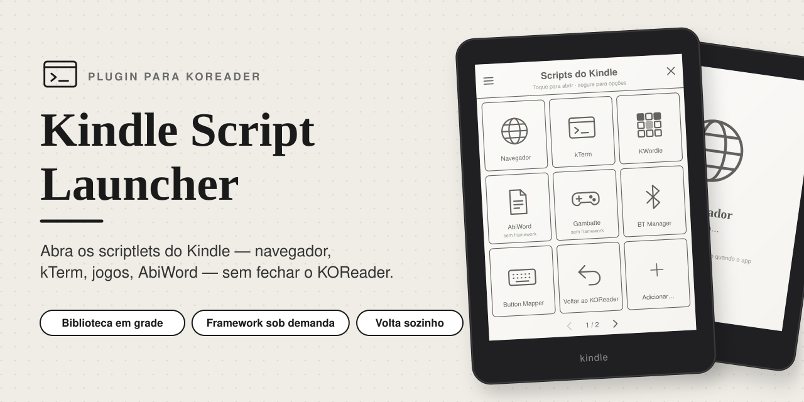
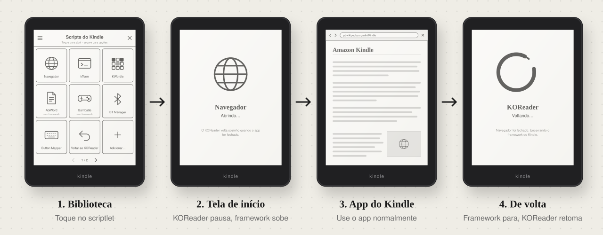
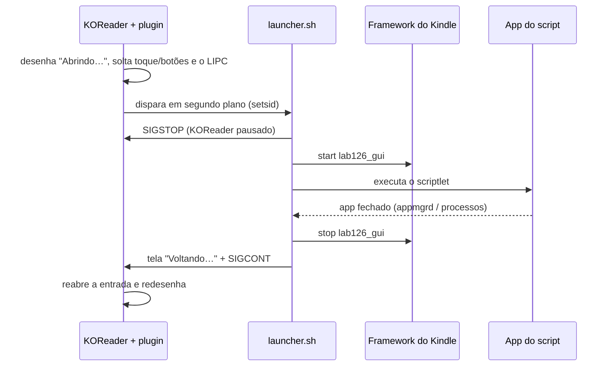

<p align="center">
  
</p>

<p align="center">
  <b>Abra os scriptlets do Kindle — navegador, kTerm, jogos, AbiWord — sem fechar o KOReader.</b>
</p>

<p align="center">
  <a href="../../releases/latest"></a>
  
  
  
  <a href="https://claude.com/claude-code"></a>
</p>

---

Quando o KOReader roda **sem o framework do Kindle** (como no `ZenReader.sh` do ZenOS), os scriptlets que
dependem da interface da Amazon — o navegador, apps do `appmgrd`, KUAL etc. — não funcionam. A saída
normal é fechar o KOReader, reiniciar o Kindle inteiro e depois voltar.

O **Kindle Script Launcher** faz isso por você, sem perder o livro aberto:

1. **pausa** o KOReader (`SIGSTOP`), sem fechá-lo;
2. **inicia** o framework do Kindle (ou não — dá para rodar scripts sem ele);
3. **executa** o scriptlet `.sh` e espera o app que ele abriu ser fechado;
4. **para** o framework e **retoma** o KOReader exatamente onde estava.

<p align="center">
  
</p>

> As imagens são ilustrações das telas do plugin, não capturas do aparelho.

## Recursos

- **Biblioteca em grade** — atalhos em tela cheia com ícone e nome de cada scriptlet, paginação por gesto,
  reordenação e ordenação A–Z / Z–A.
- **Framework sob demanda** — por script: liga o framework do Kindle só para quem precisa; o resto roda direto
  (marcado como *sem framework*).
- **Volta sozinho** — detecta quando o app aberto pelo script fecha (pelo `appmgrd` ou pelos processos que ele
  deixou rodando) e retoma o KOReader.
- **À prova de travamento** — um processo vigia retoma o KOReader mesmo se o launcher morrer no meio; o scriptlet
  *Voltar ao KOReader* força a volta manualmente.
- **Ícones bonitos no e-ink** — lê `# Icon:` do cabeçalho (data URI ou arquivo), remove fundos opacos e molduras.
- **Telas de transição** — “Abrindo…” e “Voltando…” no mesmo estilo, cobrindo a Home do Kindle enquanto o
  framework sobe e desce.
- **Integrações** — botão *Executar com framework* no toque longo do gerenciador de arquivos, ações para gestos
  (Dispatcher), e convivência com o `hidpassthrough`, o HTTP Inspector e o ZenOS.

## Requisitos

- Kindle com **jailbreak**.
- **KOReader** iniciado **sem o framework** (`STOP_FRAMEWORK=yes`), por exemplo pelo `ZenReader.sh` do ZenOS.
  Com o framework ativo o plugin não é necessário e se recusa a rodar.

## Instalação

1. Baixe o `kindlescriptlauncher.koplugin-<versão>.zip` em **[Releases](../../releases/latest)**.
2. Extraia para `/mnt/us/koreader/plugins/`, ficando assim:
   ```
   koreader/plugins/kindlescriptlauncher.koplugin/main.lua
   ```
3. Reinicie o KOReader.
4. *(Opcional)* Copie `Voltar ao KOReader.sh` para `/mnt/us/documents/` ou adicione-o pela biblioteca.

## Uso

**Menu → Ferramentas → Scripts do Kindle**

| Onde | O que faz |
| --- | --- |
| **Biblioteca de scripts** | Grade com seus scriptlets. Toque abre; deslizar troca de página. |
| Toque longo num atalho | Abrir · mover · para o início/fim · *Iniciar o framework: sim/não* · remover |
| Ícone ☰ da biblioteca | Ordenar por nome · adicionar script |
| **Escolher script…** | Escolhe qualquer `.sh` e executa |
| Gerenciador de arquivos | Toque longo num `.sh` → **Executar com framework** |
| Gestos | Ações *Biblioteca de scripts do Kindle* e *Executar script do Kindle…* |

O plugin já traz o scriptlet **Navegador** (`scripts/navegador.sh`), que abre o navegador nativo do Kindle.

### Configurações

- **Pasta inicial** — onde o seletor de scripts abre (padrão `/mnt/us/documents`).
- **Espera após iniciar o framework** — segundos para o framework estabilizar antes do script (padrão 15).
- **Ver log da última execução** — mostra `/mnt/us/koreader/kindlescriptlauncher.log`.

### Cabeçalho do scriptlet

O nome e o ícone na biblioteca vêm das primeiras linhas do `.sh`:

```sh
#!/bin/sh
# Name: Navegador
# Icon: /mnt/us/koreader/plugins/kindlescriptlauncher.koplugin/scripts/navegador.svg
lipc-set-prop com.lab126.appmgrd start app://com.lab126.browser
```

`# Icon:` aceita um caminho absoluto (PNG, JPG, SVG…) ou um data URI (`data:image/png;base64,…`).
Sem `# Name:`, vale o nome do arquivo. Scripts com `#!/bin/bash` rodam com `bash`.

## Como funciona



| Arquivo | Papel |
| --- | --- |
| `main.lua` | Plugin: menu, configurações, preparo e retomada do KOReader |
| `scriptlibrary.lua` | Biblioteca em grade |
| `kslauncher_ui.lua` | Cabeçalho dos scriptlets, tratamento de ícones, telas cheias |
| `kslauncher_exit.lua` | Tela de saída em português (substitui a do ZenOS) |
| `launcher.sh` | Pausa, framework, execução, espera e retomada (com vigia) |

## Solução de problemas

- **Ficou preso no app / não voltou** — rode o scriptlet *Voltar ao KOReader* (pelo KUAL ou pela Home).
- **O script roda antes do framework estar pronto** — aumente *Espera após iniciar o framework*.
- **Algo deu errado** — veja *Configurações → Ver log da última execução*.

## Compilar

```sh
./build.sh 0.1.0      # → dist/kindlescriptlauncher.koplugin-0.1.0.zip
```

O script verifica a sintaxe (`luac -p` e `sh -n`) e gera o zip. No GitHub, cada push é compilado pelo
Actions, e uma tag `v*` publica o zip como release:

```sh
git tag v0.1.0 && git push --tags
```

## Créditos

- Criado com [Claude Code](https://claude.com/claude-code) — código, artes e documentação.
- [KOReader](https://github.com/koreader/koreader) e [FBInk](https://github.com/NiLuJe/FBInk).
- ZenOS / [ZenLabs](https://github.com/xZenLabs) — tela de restauração e o
  [kindle-browser-scriptlet](https://github.com/xZenLabs/kindle-browser-scriptlet), base do Navegador.

## Licença

[MIT](LICENSE)
